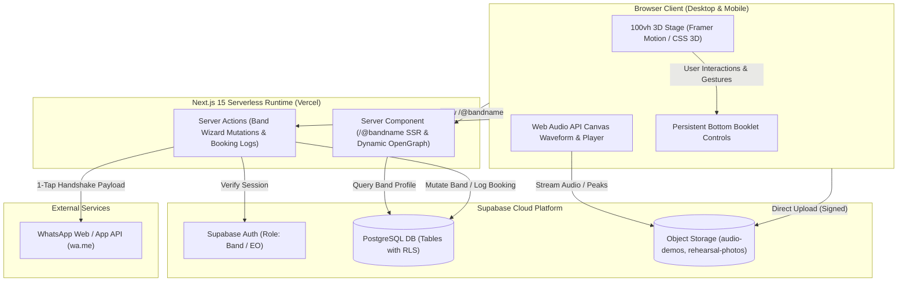
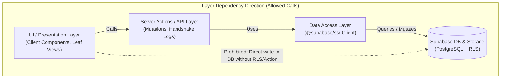
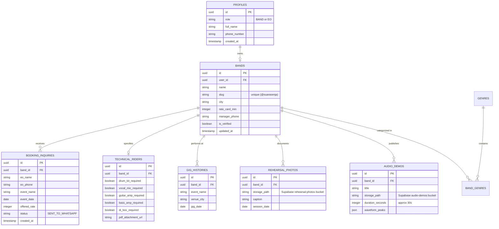

# Architecture Spine — Reffband MVP

## Design Paradigm

The Reffband MVP adopts a **Hybrid Serverless & Jamstack Paradigm** with Next.js 15 App Router:
* **Presentation Tier:** A strictly locked `100vh` viewport host running an authentic Japanese Orihon 3D Accordion booklet engine (`rotateY` on desktop, `rotateX` on mobile) built with Client Components (`"use client"`), Framer Motion, and Tailwind CSS.
* **Serverless Backend Tier:** Next.js Server Components for dynamic SSR and OpenGraph metadata generation on public band URLs (`/@bandname`), coupled with Server Actions for authenticated mutations and booking inquiry logging.
* **Persistence & Storage Tier:** Managed Supabase Cloud (PostgreSQL 16) with Row-Level Security (RLS) policies, alongside Supabase Object Storage for direct, CDN-cached 30s MP3/WAV demo streaming and Polaroid photo uploads.



---

## Invariants & Rules

### AD-1 — Next.js 15 App Router for Dynamic Social Previews & Fullstack Cohesion [ADOPTED]
* **Binds:** `R1`, `R6`, `all`
* **Prevents:** The "Invisible Band" problem where sharing a custom link on WhatsApp displays an empty or generic link bubble without the band's photo, genre, or headline.
* **Rule:** 
  1. The public dossier route `app/[bandSlug]/page.tsx` MUST be a Server Component exporting `generateMetadata()`.
  2. `generateMetadata()` must query the band's record and return OpenGraph tags (`og:title`, `og:description`, `og:image`, `twitter:card`).
  3. Interactive stages and wizards MUST be isolated as dedicated Client Components (`"use client"`).

### AD-2 — 100vh Viewport-Locked Stage & Dual-Mode Accordion Fold Kinematics [ADOPTED]
* **Binds:** `R9`, `DESIGN.md`, `EXPERIENCE.md`
* **Prevents:** Vertical page jitter, detachment of 3D origami hinges, and broken touch gestures on mobile screens.
* **Rule:** 
  1. The top-level document window MUST enforce `overflow: hidden; height: 100vh`.
  2. Vertical window scrolling is strictly prohibited; internal scrolling inside `.reader-leaf` containers MUST use `overflow-y: auto`.
  3. Media query breakpoint $\le 700\text{px}$ MUST automatically pivot kinematics:
     * **Desktop (> 700px):** Slicing 3 vertical panels ($W/3$), rotation along Y-axis (`rotateY(±52°)`), hinge origin `transform-origin: left center`, swipe travel along X ($dx \ge 65\text{px}$).
     * **Mobile (≤ 700px):** Slicing 3 horizontal strips ($H/3$), rotation along X-axis (`rotateX(±52°)`), hinge origin `transform-origin: center top`, swipe travel along Y ($dy \ge 65\text{px}$), and stacked washi paper depth shadows (`2px #c7b99f`, `4px #f6f0e3`, `5px #cbbda4`).

### AD-3 — Supabase PostgreSQL with Row Level Security (RLS) & Object Storage [ADOPTED]
* **Binds:** `R1`, `R2`, `R3`, `R4`, `R5`, `R6`, `R7`, `R8`
* **Prevents:** Ephemeral data loss on serverless restarts, separate backend boilerplate, and unauthorized modifications of band rate cards.
* **Rule:**
  1. All database access in Next.js Server Components and Server Actions MUST go through `@supabase/ssr`.
  2. PostgreSQL tables MUST enforce Row Level Security (RLS). Public users and EOs have read-only (`SELECT`) permissions on published band profiles. Only the authenticated band owner (`auth.uid() = user_id`) may execute `INSERT` or `UPDATE` on their profile, songs, or rider.
  3. Uploaded audio files and photos MUST be written to dedicated Supabase Storage buckets (`audio-demos` and `rehearsal-photos`).

### AD-4 — Client-Side Audio Validation & Native Web Audio API Waveforms [ADOPTED]
* **Binds:** `R3`, `R6`, `R7`
* **Prevents:** Serverless function timeouts caused by heavy server-side FFmpeg transcoding binaries and massive client bundle bloat.
* **Rule:**
  1. Audio files MUST be validated in the browser before upload: MIME type strictly `audio/mpeg` or `audio/wav`, file size strictly $\le 15\text{MB}$.
  2. Audio waveforms MUST be computed client-side using the native HTML5 `AudioContext.decodeAudioData()` API and drawn directly to an HTML5 `<canvas>` element. Heavy third-party waveform libraries are prohibited.

### AD-5 — Hybrid 1-Tap WhatsApp Booking Handshake & Inquiry Audit Trail [ADOPTED]
* **Binds:** `R7`, `R8`
* **Prevents:** Untracked booking leads and missing inquiry history for band managers.
* **Rule:**
  1. Triggering "AJUKAN JADWAL MANGGUNG" MUST invoke a Next.js Server Action (`logBookingInquiry`) that saves the lead into the `booking_inquiries` table (band ID, EO name, event title, date, offered honorarium, and timestamp).
  2. The Server Action then returns the formatted WhatsApp URI string:
     `https://wa.me/${manager_phone}?text=${encodeURIComponent(official_message)}`
  3. The client window immediately opens this link in a new tab, launching WhatsApp Web or mobile app seamlessly.



---

## Consistency Conventions

| Concern | Convention | Example |
|---|---|---|
| **Naming (Files & Routes)** | Kebab-case for folders and file components; camelCase for helper functions. | `components/cassette-player.tsx`, `lib/audio-decoder.ts` |
| **Data Models & Database** | Snake_case for database columns; PascalCase for TypeScript interfaces. | `rate_card_min`, `interface BandProfile { ... }` |
| **Monetary & Rate Values** | Stored as integer IDR in database; formatted with Indonesian locale on UI. | `1000000` in DB $\to$ `"Rp 1.000.000"` in UI |
| **Date & Timestamps** | ISO-8601 with timezone in DB (`timestamptz`); formatted localized text in UI. | `2026-11-10T12:00:00Z` $\to$ `"25 Des 2026"` |
| **Error Handling** | Server Actions return a standardized Discriminated Union response shape. | `{ success: true, data: T }` or `{ success: false, error: string }` |
| **State Mutation** | Next.js Server Actions with `revalidatePath()` for instant cache invalidation. | `revalidatePath('/[bandSlug]')` |

---

## Stack

| Component / Layer | Technology | Version | Purpose |
|---|---|---|---|
| **Core Framework** | Next.js (App Router) | `15.0+` | Full-stack React framework with SSR & Server Actions |
| **UI Library** | React | `19.0+` | Component architecture |
| **Language** | TypeScript | `5.0+` | Static type safety across client and server |
| **Styling** | Tailwind CSS | `v4.0+` | Utility-first design system token implementation |
| **Animation Engine** | Framer Motion | `12.0+` | Hardware-accelerated 3D accordion origami folding |
| **Database & Auth** | Supabase (PostgreSQL) | `v2.x SDK` | Managed relational database with Row Level Security |
| **SSR Supabase Client** | `@supabase/ssr` | `latest` | Secure cookie-based auth in Next.js Server Actions |
| **Icons** | Lucide React | `latest` | Analog music, audio, and UI iconography |

---

## Structural Seed

### 1. Minimal Source Tree Scaffold
```text
reffband/
├── app/
│   ├── (stage)/
│   │   ├── layout.tsx             # 100vh locked stage root wrapper
│   │   └── page.tsx               # 5-leaf 3D accordion booklet container
│   ├── [bandSlug]/
│   │   ├── page.tsx               # Public SSR EPK dossier (@bandname)
│   │   └── opengraph-image.tsx    # Dynamic OpenGraph preview generator
│   ├── api/
│   │   └── upload/route.ts        # Direct Supabase storage signed URL handler
│   ├── globals.css                # Custom scrollbars, washi shadows & perspective
│   └── layout.tsx                 # Root layout with Archivo Black & Space Mono fonts
├── components/
│   ├── stage/
│   │   ├── accordion-fold-mesh.tsx # 3D origami leaf slicer (rotateY / rotateX)
│   │   ├── reader-controls.tsx    # Persistent bottom paging bar
│   │   └── chapter-ribbon.tsx     # Checkered / vinyl groove bottom strip
│   ├── leaves/
│   │   ├── leaf-01-gatekeeper.tsx # Role bifurcation (Band vs EO)
│   │   ├── leaf-02-wizard.tsx     # 4-step EPK studio form & preview
│   │   ├── leaf-03-public-epk.tsx # Dossier layout & 3-column zine
│   │   ├── leaf-04-discovery.tsx  # EO search, filters & talent roster
│   │   └── leaf-05-scorecard.tsx  # UX architecture scorecard
│   └── media/
│       ├── cassette-deck.tsx      # Analog tape audio player with spinning reels
│       └── waveform-canvas.tsx    # Native HTML5 Web Audio API peak visualizer
├── lib/
│   ├── supabase/
│   │   ├── client.ts              # Browser Supabase client
│   │   └── server.ts              # Next.js Server Component / Action client
│   ├── audio/
│   │   └── decoder.ts             # Web Audio API peak extraction logic
│   └── whatsapp/
│       └── payload-builder.ts     # Official Indonesian booking message encoder
├── types/
│   └── database.types.ts          # Auto-generated Supabase TypeScript schema
└── public/
    └── extracted_assets/          # Logo R, Kaset MK-60, Vinyl LP, Silhouettes
```

---

### 2. Core Entity-Relationship Diagram (ERD)



---

## Capability → Architecture Map

| Capability / Requirement | Lives in | Governed by |
|---|---|---|
| **R1: Role Gatekeeper & Switcher** | `components/leaves/leaf-01-gatekeeper.tsx` | AD-1, AD-2 |
| **R2: Band Profile & Genre Tagging** | `components/leaves/leaf-02-wizard.tsx` | AD-3 |
| **R3: 30s Audio Demo & Waveform** | `components/media/cassette-deck.tsx` | AD-3, AD-4 |
| **R4: Studio Polaroid & Gig History** | `components/leaves/leaf-02-wizard.tsx` | AD-3 |
| **R5: Technical Rider & 100% Meter** | `components/leaves/leaf-02-wizard.tsx` | AD-3 |
| **R6: Public Dossier & Dynamic OG** | `app/[bandSlug]/page.tsx` | AD-1, AD-3 |
| **R7: EO Talent Discovery Multi-Filter** | `components/leaves/leaf-04-discovery.tsx` | AD-1, AD-3 |
| **R8: 1-Tap WhatsApp Booking Handshake** | `lib/whatsapp/payload-builder.ts` | AD-5 |
| **R9: Dual-Mode 3D Booklet Kinematics** | `components/stage/accordion-fold-mesh.tsx` | AD-2 |

---

## Deferred

* **In-App Escrow Payment Gateway:** Deferred to post-MVP. Reason: Indie bands and local venues operate on trust-based direct bank transfers and down-payment terms negotiated via WhatsApp. Adding payment escrow adds immense financial compliance friction without validating core booking demand.
* **Audience Ticketing & E-Commerce:** Deferred to Phase 2. Reason: MVP is strictly a B2B talent matchmaking tool between Musician and Event Organizer.
* **In-App Messaging / Live Chat:** Deferred. Reason: WhatsApp is the ubiquitous communication channel in Indonesia; building in-app chat creates duplicate friction and delays booking closure.
