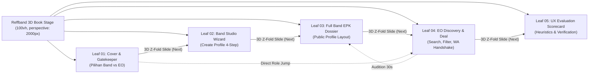

# Reffband Experience Specification (EXPERIENCE.md)

## 1. Foundation & Architectural Model

### 1.1 Product Paradigm: The "3D Accordion Gig Zine & Cassette Dossier"
Adapted from the Orihon booklet architecture documented in [`references/ACCORDION_PAGING_GUIDE.md`](file:///D:/dandy_personal/Dandy_College/SEMESTER_3/Bisdig/Reffband/references/ACCORDION_PAGING_GUIDE.md), [`references/TEARDOWN.md`](file:///D:/dandy_personal/Dandy_College/SEMESTER_3/Bisdig/Reffband/references/TEARDOWN.md), and [`references/book-reader.js`](file:///D:/dandy_personal/Dandy_College/SEMESTER_3/Bisdig/Reffband/references/js/book-reader-d796e39c0771.js), Reffband delivers an editorial, physical concert zine experience:
- **Strictly 100vh Viewport-Locked Stage:** The window scroll height is locked at 100vh (`overflow: hidden`). Content never stacks infinitely in a vertical scroll feed.
- **Horizontal Left-to-Right Slide Navigation:** Navigating between pages travels horizontally across the stage (`[← Prev Leaf]` and `[Next Leaf →]`).
- **Signature 3D Accordion Z-Fold:** Switching leaves divides the outgoing page into 3 vertical panels (`fold-leading`, `fold-mountain`, `fold-valley`) rotating $\pm 52^\circ$ in 3D space (`perspective: 2000px`) with dynamic face illumination and real-time SVG ground shadow projection.
- **Internal Leaf Scrolling:** Long forms or dossiers scroll internally within `.reader-leaf` using custom retro scrollbars, keeping the outer book frame rock-solid.

---

## 2. Information Architecture: The 5 Booklet Leaves

---

## 3. Motion & Interaction Primitives

### 3.1 The 3D Accordion Z-Fold Engine
1. **Geometric Partition:**
   The page is divided into 3 vertical panels ($W/3$ each).
2. **Hinge Nesting:**
   Panels are nested with `transform-style: preserve-3d`. Panel 1 is a child of Panel 0; Panel 2 is a child of Panel 1.
3. **Motion Curves (1280ms duration):**
   - Opening angle $\theta(t)$ expands to $52^\circ$.
   - Panel 0 rotates by $+1 \cdot \theta(t)$.
   - Panel 1 rotates by $-2 \cdot \theta(t)$ (creasing backward).
   - Panel 2 rotates by $+2 \cdot \theta(t)$ (creasing forward).
   - The leaf translates along $X$ (`shift`) and lifts along $Z$ (`lift: 22px`).
4. **Dynamic Face Lighting (`.accordion-light`):**
   Simulates a virtual stage spotlight from the top-left; panels rotating away darken with `#28251F`, while facing panels brighten with `#FFFBED`.
5. **Real-Time Projected Ground Shadow:**
   An SVG polygon shadow traces the 4 vertex points on the ground paper beneath, with blur scaling with lift.

### 3.2 Horizontal Slide Interaction (Keyboard & Touch)
- **Swipe Gestures:** Touch swipe left moves forward (Next Leaf); swipe right moves backward (Prev Leaf) with a $48\text{px}$ activation threshold.
- **Keyboard Navigation:** `ArrowRight` (Next), `ArrowLeft` (Prev), `Digit1-5` (Jump to Leaf).
- **Reduced Motion Support:** Users with `prefers-reduced-motion: reduce` receive an instantaneous, high-performance horizontal fade transition without 3D rotation.

### 📱 3.3 Smartphone Adaptive Interaction Model: Vertical Calendar Fold ($\le 700\text{px}$)
When the viewport width is $\le 700\text{px}$ (smartphones):
1. **Behavioral Paradigm Shift:**
   - Instead of horizontal book folding (`rotateY`), the stage switches to a **Japanese hanging calendar fold (`rotateX`)**.
   - Hinge origin pivots to `transform-origin: center top`.
   - Outgoing pages slice into 3 horizontal panels ($H/3$ each).
2. **Directional Touch & Pointer Gesture Physics:**
   - Pointer events monitor primary vertical travel ($dy$) against horizontal cross travel ($dx$).
   - Activation requires $|dy| \ge 65\text{px}$ and $|dy| \ge 1.3 \cdot |dx|$.
   - Swipe Up ($dy < -65\text{px}$) flips upward to the Next Leaf (`SELANJUTNYA ↓`).
   - Swipe Down ($dy > +65\text{px}$) unrolls downward to the Prev Leaf (`↑ SEBELUMNYA`).
3. **Internal Leaf Touch Action:**
   - `.reader-stage` specifies `touch-action: pan-x` (or internal container `overflow-y: auto`), allowing long vertical forms and EPK dossiers to be scrolled naturally without triggering accidental page fold turns.
4. **Elevation & Edge Stacking:**
   - Stacked washi paper edge shadows (`2px 1px 0 #c7b99f`, `4px 2px 0 #f6f0e3`, `5px 3px 0 #cbbda4`) convey physical zine booklet depth on compact mobile viewports.
5. **Compact Control Bar:**
   - Fixed height drops to `52px`, control labels dynamically swap to `[↑ SEBELUMNYA]` and `[SELANJUTNYA ↓]`, while keyboard binds `ArrowUp` and `ArrowDown`.

---

## 4. Detailed Specification of the 5 Leaves

### 🎸 Leaf 01: Cover & Gatekeeper (Pilihan Peran Band vs EO)
* **Purpose:** Zero-friction orientation and bifurcation into user roles.
* **Header:** Brand lockup "REFFBAND" with logo "R" + *Role Switcher Pill* in navbar.
* **Visual Spread:**
  * Left: Hero concert collage with extracted band silhouette and sunburst stage lights.
  * Right: Two prominent cards with distinct visual metaphors:
    * **Musisi / Band:** Wine Maroon `#7E1929` card with extracted MK-60 Cassette Cutout $\to$ CTA `MASUK KE STUDIO BAND ➔` (navigates to Leaf 02).
    * **Event Organizer / Venue:** Mustard Yellow `#F5C542` card with extracted Vinyl LP Cutout $\to$ CTA `CARI BAND SEKARANG ➔` (navigates to Leaf 04).

### 🎛️ Leaf 02: Band Studio Wizard (Create & Edit Band Profile)
* **Purpose:** Intuitive onboarding for bands to compile their digital EPK in 4 structured steps.
* **Layout:** Two-column spread:
  * **Left Column (4 Form Cards):**
    1. *Identitas & Genre:* Nama band, domisili, tarif standar (*rate card*), dan chip genre interaktif.
    2. *Portofolio Audio Demo:* Dropzone upload audio MP3/WAV berbingkai kaset MK-60 + waveform preview + tautan Spotify/YouTube.
    3. *Riwayat Event & Latihan Studio:* Tabel daftar panggung sebelumnya + upload polaroid latihan studio & video rehearsal (mencegah band fiktif).
    4. *Sosial Media & Technical Rider:* Tautan IG/TikTok/WhatsApp manajer + checklist kebutuhan alat panggung (drum kit, mic, amp, DI box).
  * **Right Column (Sticky UX Feedback):**
    * *EPK Completeness Meter:* Progres lingkaran `100% VERIFIED READY`.
    * *Live Cassette Card Instance:* Pratinjau kaset yang langsung terupdate secara real-time.

### 📄 Leaf 03: Full Band Profile Layout (Public EPK Dossier)
* **Purpose:** Publicly shareable dossier (`reffband.id/@suarasenja`) that EOs can examine to make hiring decisions.
* **Layout:** 3-Column Concert Zine Dossier:
  * *Hero Banner:* Stage lighting collage, stempel domisili *"JAKARTA SELATAN"*, tarif *"Rp 1.000.000 / GIG"*, dan CTA `BOOKING BAND VIA WHATSAPP ➔`.
  * *Column 1:* Audio Demo player (Kaset MK-60 30-detik) & Piringan Hitam Diskografi.
  * *Column 2:* Galeri Polaroid foto latihan studio bertanggal & tiket konser (*ticket stubs*) panggung lampau.
  * *Column 3:* Matriks kebutuhan panggung *Technical Rider* & tautan sosial media resmi.

### 🔍 Leaf 04: EO Talent Discovery & Filter Dashboard
* **Purpose:** Curated discovery and instant booking for Event Organizers and Venues.
* **Layout:**
  * *Filter Header:* Instant search bar, genre filter chips (*Indie Folk, Alternative Rock, Midwest Emo, Grunge, Pop Punk*), dan dropdown budget.
  * *Cassette Talent Roster (Grid 3 Kartu):* Setiap kartu kaset dilengkapi tombol `▶ PLAY 30s DEMO` untuk mendengarkan lagu di tempat tanpa membuka tab baru (*zero-page-load audition*).
  * *Bottom Handshake Bar:* Tombol `AJUKAN JADWAL MANGGUNG` yang secara otomatis menghasilkan draf pesan WhatsApp resmi yang sudah terisi data acara ke manajer band.

### 📊 Leaf 05: UX Architecture Scorecard & Heuristic Verification
* **Purpose:** Papan evaluasi untuk membuktikan dan mengukur kualitas UX Reffband.
* **Evaluation Criteria:**
  1. *Hick's Law (Role Clarity):* Hanya 2 pilihan peran kontras tinggi di Leaf 01.
  2. *Goal-Gradient Effect:* Form di Leaf 02 dipecah menjadi 4 kartu terstruktur dengan progress meter.
  3. *Zero-Page-Load Audition:* Di Leaf 04, pemutar kaset inline menghemat waktu EO hingga 80%.
  4. *Trust & Verification Signals:* Foto latihan studio dan technical rider di Leaf 03 menghapus keraguan EO.
  5. *WCAG AAA Contrast & Fitts's Target:* Rasio kontras 14.8:1 dan ukuran target sentuh $\ge 44\text{px}$.
  6. *Tactile Accordion Delight:* Animasi 3D Z-fold menghadirkan sensasi membolak-balik zine fisik asli.

---

## 5. Voice and Tone (Microcopy Matrix)

| Konteks | Bahasa Korporat Kaku (Hindari) | Suara Komunitas Indie Reffband (Gunakan) |
| :--- | :--- | :--- |
| **Pilihan Peran** | "Silakan pilih tipe registrasi Anda" | *"Pilih Peranmu di Skena: Musisi atau Event Organizer"* |
| **Upload Audio** | "Unggah file audio MP3 di sini" | *"Drop Rekaman Demomu ke Pita Kaset (MP3/WAV maks. 15MB)"* |
| **Bukti Latihan** | "Lampirkan bukti verifikasi band" | *"Dokumentasi Latihan Studio: Tunjukkan Bandmu Siap Manggung!"* |
| **Inline Player** | "Putar pratinjau audio" | *"▶ Putar Cuplikan Demo (30s Tape Audition)"* |
| **Booking WhatsApp** | "Submit data reservasi" | *"Ajukan Jadwal Manggung ke Manajer via WhatsApp ➔"* |
